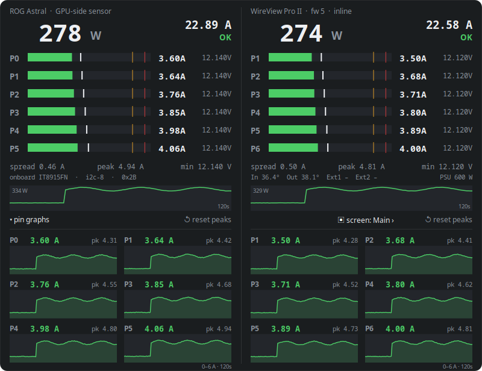

# astral-pins

Per-pin **12V-2x6 / 12VHPWR** current monitoring and over-current watchdog for Linux:
the GPU Tweak III "Power Detector+" experience for **ASUS ROG Astral** RTX 50 cards,
plus optional **Thermal Grizzly WireView Pro II** support.



## Features

- **Live per-pin readings** from the ROG Astral's onboard current sensor (ITE IT8915FN,
  read over the NVIDIA driver's I2C buses), no root needed once access is granted.
- **Watchdog** (systemd user service), checked every second, alert after 3 s sustained:

  | Condition | Level |
  |---|---|
  | any pin ≥ 9.5 A | critical |
  | any pin ≥ 8.5 A | warning |
  | max−min pin spread ≥ 3 A while total ≥ 15 A | warning |
  | a pin below 11.4 V while total ≥ 10 A | warning |
  | WireView device fault flag set | warning |

  Alerts pop up a KDE dialog offering **Shut down now / Ignore**. An unanswered
  **critical** alert powers the PC off after **30 s** if the problem is still present.
- **Tray icon** (StatusNotifierItem): six live bars, one per pin; colored border on
  alerts. Left-click opens a popup *anchored to the icon* (Wayland layer-shell) with
  per-device cards: total power, per-pin bars with peaks and 8.5/9.5 A marks,
  voltages, power history, and optional per-pin graphs.
- **WireView Pro II** (USB): second card with per-pin current/voltage, totals,
  temperature probes, PSU power limit, fault flags, and a button to cycle the
  device's display screen.

## Supported hardware

| Device | Status |
|---|---|
| ASUS ROG Astral RTX 5080 (subsystem `1043:8A45`) | tested |
| ASUS ROG Astral RTX 5090 / other Astral RTX 50 | same sensor per community reports, untested here |
| Thermal Grizzly WireView Pro II (fw 5) | tested |
| WireView Pro II Noctua Edition | same protocol per community reports, untested here |

Other GPUs have no per-pin sensor; the WireView part works with any GPU.

## Requirements

- Python 3 (standard library only for the watchdog)
- NVIDIA proprietary or open kernel driver (exposes the `NVIDIA i2c adapter` buses), `i2c-dev` module
- Tray: PyGObject, GTK 3, gtk-layer-shell, pycairo
  - Fedora: `python3-gobject gtk3 gtk-layer-shell python3-cairo`
  - Debian/Ubuntu: `python3-gi python3-gi-cairo gir1.2-gtk-3.0 gir1.2-gtklayershell-0.1`
- Alert dialog: `kdialog` (KDE Plasma); notifications: `notify-send`

Developed on Fedora Kinoite / Bazzite, KDE Plasma on Wayland.

## Install

```bash
tar xzf astral-pins-*-linux.tar.gz && cd astral-pins-*/
./install.sh --system   # first time: udev rules for I2C + WireView access (asks for sudo)
```

`./install.sh` alone (no root) installs into `~/.local/bin` and enables the
`astral-pins` and `astral-pins-tray` systemd **user** services. If OpenRGB's or
ddcutil's udev rules already give you `/dev/i2c-*` access, `--system` is only needed
for the WireView. Use `--no-tray` to skip the tray.

Remove with `./uninstall.sh` (add `--system` to remove the udev rules too).

## Usage

```bash
astral-pins                   # live per-pin view in the terminal
astral-pins --once            # one reading
astral-pins --test-alert      # show the alert with fake data ("Shut down" is a dry run)
astral-pins --wv-screen temp  # switch WireView display: main|simple|current|temp|status
journalctl --user -u astral-pins -f
```

Thresholds are constants at the top of the watchdog section in `astral-pins`.

## How it talks to the hardware

**ROG Astral** — I2C address `0x2B` on one of the NVIDIA buses, 24 bytes from register
`0x80`: 6 pins × (u16 mV, u16 mA), big-endian, SMBus byte-data **reads only**.

**WireView Pro II** — USB CDC-ACM (`0483:5740`), 115200 8N1, polled. Commands sent:
`0x01` (identify), `0x04` (100-byte little-endian sensor frame, sanity-checked since the
protocol has no CRC), and `0x0C <E0–E4>` (screen change, only on request). Config
writes, fault clearing, calibration, flash and bootloader commands are never sent.
Only one program can hold the port: don't run the vendor app or `wireviewd` at the
same time.

Programs share data through `$XDG_RUNTIME_DIR/astral-pins.json` and `wireview.json`;
the tray never touches the hardware.

## Disclaimer

Not affiliated with ASUS or Thermal Grizzly. The register layouts come from community
reverse engineering and may change with firmware updates. This is a monitoring aid,
not a certified safety device: inspect and seat your power cable properly.

## Credits

- [vhpwr-guard](https://github.com/eugeneoh04/vhpwr-guard) — Astral sensor register layout
- [wireview-hwmon](https://github.com/emaspa/wireview-hwmon) and
  [wireview-linux](https://github.com/emaspa/wireview-linux) — WireView Pro II protocol
- [wireview-monitor](https://github.com/panayotovip/wireview-monitor)

## License

[MIT](LICENSE)
